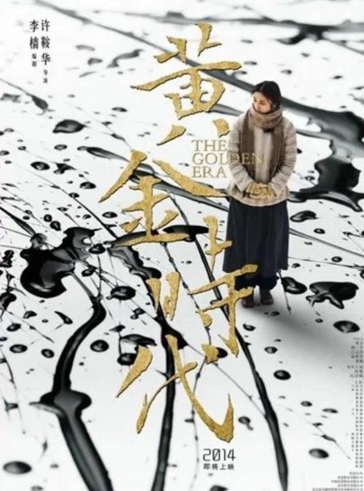
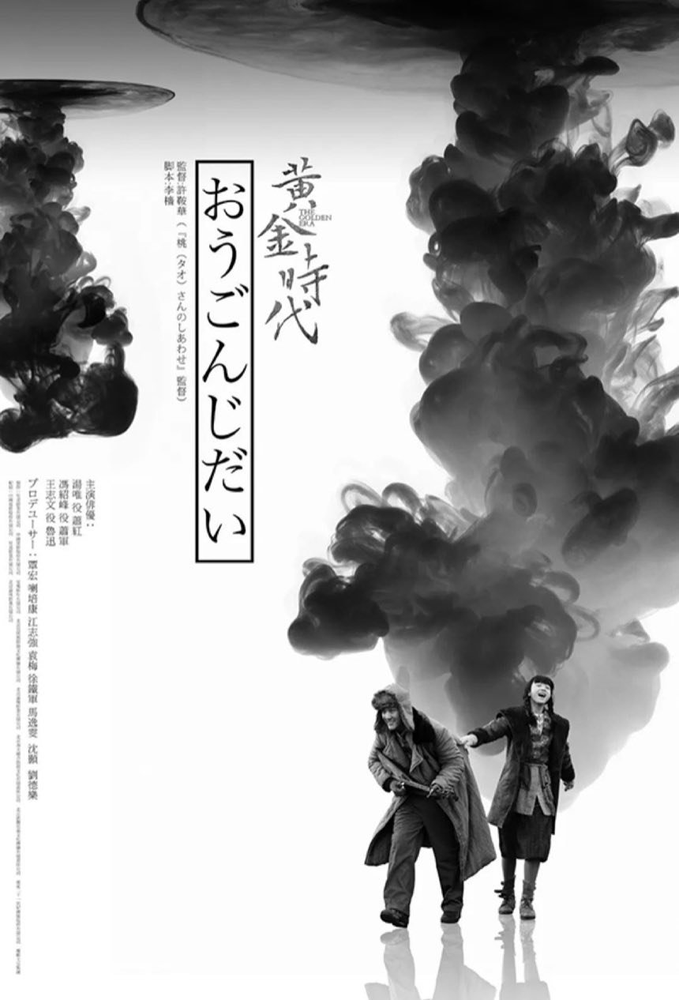

# 黄海《黄金时代》海报鉴赏

> west2-online / learn-design · term1 · task1
> 分析对象：《黄金时代》大陆先导版与日本版海报
> 领域：平面设计（海报）
> 日期：2026-10-21

### 基本信息

- 提交者：pppppepper
- 方向：平面设计（海报）
- 提交日期：2026/10/21
- 版本：1.0.0

## 作品信息

| 项目 | 大陆先导版 | 日本版 |
| :---: | :---: | :---: |
| 作品名称 | 《黄金时代》先导海报（「天地」版） | 《黄金时代》日本版海报 |
| 设计师 | 黄海（竹也文化工作室） | 黄海（竹也文化工作室） |
| 发布 | 2014 年 1 月 22 日首曝 | 2014 年，日本发行 |
| 面向观众 | 华语观众 | 日本观众 |
| 物料性质 | 先导海报，上映前造势 | 地区发行海报 |
| 所属影片 | 《黄金时代》，许鞍华导演，汤唯饰萧红 | 同左 |
| 配图 | `images/golden-era-teaser.jpg` | `images/golden-era-japan.jpg` |
| 影片条目 | <https://movie.douban.com/subject/10545939/> | 同左 |





---

## 一、个人感想

我是在提高自己平面方向的审美积累时遇到黄海的。顺着《太阳照常升起》找到《黄金时代》，才发现同一部电影有这么多张长得完全不一样的海报。

我在鉴赏《黄金时代》海报时，发现同样的主题面向不同受众，会长出几种截然不同的海报风格。同一位设计师、同一年、同一部电影、同样用水墨、同样把人做得很小，最后却一个独身、一个成双。

当我第一次看到这两张海报时，发现先导版海报更突出的是电影的主题——金色的四个大字 **“黄金时代”** 写在海报的正中央，它更像一幅字，而日本版更像一幅画。我认为可能是面向的观众不同，所以海报中文字和图片的排版也有所不同：《黄金时代》是中国的作品，国人对此有一定的了解，并且也认识汉字，因此把四个大字写在中间可以非常直观地展现给观众；而日本版的海报则倾向于通过海报中的画面（如倒着向下的墨水等）来向观众传达这个影片要表达的主题和内容。

## 二、专业分析

### 2.1 两张海报的共同点

- 同一部电影、同一年、同一位设计师；
- 同样使用中国水墨语言；
- 同样使用毛笔字形作为标题；
- 人物都是远景、都被大幅的墨包围、尺度在画面里都极小。

我认为水墨与毛笔字形这两个共同点，是这个题材的海报里几乎必然出现的东西：《黄金时代》讲述的是民国女作家萧红的一生，对一个与写作相伴一生的文人来说，笔墨既是她个人形象的代表，也是典型的东方意象。除此之外，两版里笔墨都充当人物生存的背景——无论倾泻而下的墨，还是泼洒在纸上的墨，都能体现出主人公所处年代的“乱世”特征。

### 2.2 区别

- **先导版**：萧红独自站立，一身素衣，位于画面下方偏一侧，安静、不动。金色书法大字「黃金時代」占据画面上部，体量远超人物。
- **日本版**：两个人在墨云下牵手向前，姿态是行进中的。墨占了画面上方约三分之二，从右上向左下倾泻。

这里的差异主要体现在人数和主人公的动作上，而我认为这两条差异背后是同一个问题：**观众认不认识画面里这个人。**

华语观众知道萧红是写《呼兰河传》的女作家——这个认知是现成的，所以设计师可以让她一个人安安静静站着，什么都不做。我认为她的孤独本身也可以成为一种内容，容易与华语观众达成共识；看到海报时，观众自己会根据已有的认知补上剩下的一切。

然而日本观众却不知道。如果给他们一张"一个女人站在墨里"的画面，他们只会问"这是谁"。于是黄海在海报里加了一个男人，来体现他们之间的关系，丰富了萧红的人物形象：两个人、牵着手、在跑。爱情是全世界通用的语言，不需要任何前置知识就能看懂。而且电影里萧红与萧军、端木的感情确实占了大半篇幅，所以日本版处理成爱情不算凭空捏造。

### 2.3 墨的含义

黄海对这张先导版的墨有过明确的解释：

> 「那一片泼墨象征着乱世，而汤唯静静地站在纯白的纸上，那种坚定非常有冲击力。」
> ——《设计师黄海，为电影海报做减法》，人民日报《环球人物》2015-04-06

- 在先导版里，墨 = 乱世，人 = 在乱世中站定不动的人。
- 在日本版里，墨的压迫感弱了一层。多家媒体对日本版的描述是"天地水墨之间的两个嬉戏小人"（见参考与引用中网易号一文），认为墨从"乱世"变成了"天地"。这一点我不完全同意：日本版那片一反常态、自右上向左下倾泻而出的墨，在我看来仍然有"乱世"的分量——它不是压下来的，是正在垮下来的。

### 2.4 先导版的金色

先导版最显眼的还有金色——金色的书法大字。

我认为这个选择是全片最漂亮的一个双关：片名叫"黄金时代"，但这四个字不是片方起的，是萧红自己的话。她在日本写给萧军的信里说：

> 「窗上洒满着白月的当儿……'这不就是我的黄金时代吗？此刻。'……自由和舒适，平静和安闲，经济一点也不压迫，这真是黄金时代。」
> （引自每日经济新闻 2017-06-01 相关报道，链接见参考与引用。）

可是写下这句话的时候，她贫病交加、被爱人反复伤害。所以我认为，“黄金时代”指的不是物质上的富足，而是精神上的丰裕。而萧红真正的力量来自文字——对一辈子靠写作活着的人来说，文字的世界才是她强大而纯粹的地方。因此在海报的画面上，除了主题的金色字以外，并没有别的地方体现出物质层面的富足感。

### 2.5 我认为的各自的不足

- **先导版**：我认为这张海报的金色字体与背景的笔墨没有拉开层次，两者在画面上部挤在一起，所以我第一次看的时候会有一种杂乱感。
- **日本版**：虽然加入一个人能更好地丰富萧红的人物形象，但是对于不了解萧红的观众来说，很容易把这个以萧红为中心的人物传记影片认为是一部爱情片。然而这个影片的核心并不是爱情，而是写作——但日本版里除了墨以外没有任何一个字、一支笔、一本书。我认为没有很好地贴合主题。

## 三、未来展望

- **对不同的受众群体展现海报不同的重点。** "藏"是有条件的，本钱是观众脑子里已有的东西。先导版敢让萧红一个人站着、敢让片名书法字比人还大，是因为华语观众自带对萧红的认知；日本版必须给她一个伴、给她一句口号，是因为那边的观众什么都没有。所以以后做东西我会先问一句：观众认识什么，再决定藏什么、露什么。

- **我学会了一个鉴赏海报的办法：先把自己换成另一批观众，再看一遍。** 同一张海报，站在认识萧红的人的立场上看，和站在完全不认识她的人的立场上看，得出的结论完全不同。很多我一开始觉得"没设计""太直白"的处理，换个立场就能看出它的理由。

- **我的看法变过两次。** 第一次是查到"黄金时代"这四个字出自萧红旅日时写给萧军的信，而且是在最惨的时候说出的反讽——我原本准备批评日本版那句「それでも、自由でありたい」太空泛，现在认为它是有来历的。第二次是对日本版的整体评价：一开始我觉得它只是把萧红浪漫化了、太讨好，现在我认为这个简化有它的道理，只是代价明确——它丢掉了"写作"这个内核。我仍然不认同它，但我理解它为什么这么做。

---

## 参考与引用

| 出处 | 内容 | 我的评价 |
| :---: | :---: | :---: |
| 人民日报《环球人物》2015-04-06《设计师黄海，为电影海报做减法》<br><https://paper.people.com.cn/hqrw/html/2015-04/06/content_1558702.htm> | 黄海自述"泼墨象征乱世"，以及"做减法"的说法 | 这篇文章既是我的论据，也是我的检验工具。把"泼墨=乱世"套到日本版上失效的那一刻，"同一个语言跨海就变味"才真正成立 |
| 中国新闻网 2014-01-22《许鞍华"黄金时代"首曝海报 汤唯素衣独自伫立》<br><https://www.chinanews.com.cn/yl/2014/01-22/5768365.shtml> | 先导「天地」版海报的发布报道 | 用来确认先导版的发布时间、官方命名与画面描述。引用别人的观点前，先搞清他说的到底是哪一张 |
| 每日经济新闻 2017-06-01 相关报道<br><https://m.nbd.com.cn/articles/2017-06-01/1207974.html> | 引萧红在日本写给萧军的信原文，及许鞍华的评价 | 让我确认"黄金时代"出自萧红旅日时期，且是一句反讽。这是这次分析里唯一一次被事实推翻自己结论的地方 |
| 网易号《这位天才设计师，把中国电影海报送上世界之巅》<br><https://www.163.com/dy/article/CNROOI8400018AOR.html> | 对各地区版本的逐一描述，含日本版"天地水墨间的两个小人" | 帮我确认"把爱情画出来"是日本版的首创。但我不认同它用"嬉戏"形容那两个人的姿态——我看到的更像是奔逃 |
| 豆瓣《黄金时代》条目<br><https://movie.douban.com/subject/10545939/> | 影片基本信息 | 用于核对导演、主演、年份 |

## 配图说明

- `images/golden-era-teaser.jpg`：大陆先导「天地」版，526×710，76KB。用于画面层级（书法字 > 人）、人物姿态（独身静立）、墨与人比重关系的拆解。来源为本人截取的网络宣发物料。
- `images/golden-era-japan.jpg`：日本版，860×1266，95KB。用于构图、人物尺度、视线动线拆解；右上角日文口号与竖排片名为关键细节，缩放后仍清晰可辨。
- 两版原作者均为黄海（竹也文化工作室），仅作分析引用。

## 目录说明

```
pppppepper
├── README.md     本文件，即分析正文
└── images/       正文配图
```
